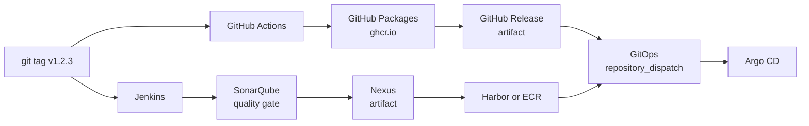

# DevOps pipeline

Every `sample-*` repository uses this pipeline, and this file is the same in all of them.
The repositories differ only in the `Dockerfile` and in `scripts/smoke.sh`.

| Trigger | GitHub Actions | Jenkins |
| --- | --- | --- |
| Pull request or push to `main` | `ci.yml`: build, test, smoke test, artifact | Build, test, smoke test, artifact |
| Tag `v*` | `release.yml`: CI, then GHCR image, GitHub Release, deploy | CI, then SonarQube, Nexus artifact, Harbor or ECR image, deploy |



Use one release path for a repository. When both paths deploy, each tag is deployed twice.

## Repository contract

| File | Contract |
| --- | --- |
| `Dockerfile` | Stage `build` runs the tests on the build platform. Stage `artifact` holds the release artifact only. The last stage is the runtime image. A failed test fails every image build. |
| `scripts/smoke.sh IMAGE [VERSION]` | Starts the image and checks the runtime contract. Needs only `docker` and `jq` on the host. |
| `scripts/release.sh` | Release steps that GitHub Actions and Jenkins share: `tag`, `artifact`, `deploy`. |
| `Jenkinsfile` | Calls `samplePipeline()` from the Jenkins shared library [nalbam/jenkinsfiles](https://github.com/nalbam/jenkinsfiles). |
| `.github/workflows/ci.yml`, `.github/workflows/release.yml`, `Jenkinsfile`, `scripts/release.sh`, `docs/pipeline.md` | The same in every repository. |

Runtime contract of every image:

- The build argument `VERSION` becomes the environment variable `VERSION`. A release image reports its tag, for example `v1.2.3`.
- The server listens on the environment variable `PORT`. The default is the port in `EXPOSE`.
- `GET /health` returns HTTP 200 with JSON that contains `"result": "ok"` and `"version": "<VERSION>"`.
  `sample-grpc` serves the gRPC health service (`grpc.health.v1.Health`) instead.
- The process runs as a non-root user.

## Build and test locally

Prerequisites: Docker with Buildx, and `jq`.

```bash
docker buildx build --load -t app:dev --build-arg VERSION=v0.0.0-dev .   # build and test
scripts/smoke.sh app:dev v0.0.0-dev                                       # smoke test
scripts/release.sh artifact app v0.0.0-dev dist                           # dist/app-v0.0.0-dev.tar.gz
```

`docker buildx build --target build .` runs only the tests.

## CI

`ci.yml` runs on pull requests to `main`, on pushes to `main`, and from `release.yml`:

1. Lints `scripts/*.sh` with `shellcheck`.
2. Builds the image for `linux/amd64` and `linux/arm64`. The `build` stage runs the tests once.
3. Loads the `linux/amd64` image and runs `scripts/smoke.sh`.
4. Exports the artifact to `dist/`. A tag run uploads it for the release job.

CI uses no secrets and publishes nothing.

## Release with GitHub Actions

GitHub Actions -> GitHub Packages (GHCR) -> GitHub Release -> deploy.

1. Choose a `main` commit with a successful `ci` run.
2. Push a SemVer tag on it:

   ```bash
   git tag v1.2.3 <commit>
   git push origin v1.2.3
   ```

   The tag must be `vMAJOR.MINOR.PATCH` with an optional prerelease, for example `v1.3.0-rc.1`.
   Leading zeros, `+build` metadata and tags longer than 128 characters fail the release.
   The tag is the only version source.

`release.yml` then runs these jobs. Each job starts only when the previous job succeeds.

| Job | Result |
| --- | --- |
| `tag` | Checks the tag. Only the highest stable tag (`vX.Y.Z`) moves `latest`. |
| `ci` | Runs `ci.yml` on the tagged commit. |
| `package` | Pushes `ghcr.io/<owner>/<repo>:<tag>` for `linux/amd64` and `linux/arm64`, and `latest` for the highest stable tag. A re-run of an older tag does not move `latest` back. |
| `release` | Creates the GitHub Release with the image digest, generated notes and the CI artifact (`<repo>-<tag>.tar.gz` and `.sha256`). A prerelease tag creates a prerelease. A re-run updates the notes and the assets. |
| `alpha` | Sends the GitOps event for phase `alpha`. Runs only when the variable `GITOPS_REPO` is set. |
| `prod` | Stable tags only. Uses the environment `prod`; add required reviewers there to approve each deploy. Sends phase `prod` with `auto_merge: true`. |

Releases run one at a time per repository. A running release is not cancelled.
GitHub keeps one waiting run per concurrency group, so a newer tag cancels an older waiting run. Re-run that run from the **Actions** tab.

Repository settings:

| Setting | Value |
| --- | --- |
| Variable `GITOPS_REPO` | `owner/repo` of the GitOps repository, for example `opspresso/argocd-env-apps`. Empty: no deploy. |
| Secret `GITOPS_TOKEN` | Token that can send `repository_dispatch` to `GITOPS_REPO` (fine-grained: Contents read and write). Needed only with `GITOPS_REPO`. |
| Environment `prod` | Optional required reviewers for the `prod` job. |
| GHCR package | When the package exists, **Manage Actions access** must give this repository write access. |

The workflows use `GITHUB_TOKEN` with `packages: write` only in `package` and `contents: write` only in `release`.

Check a release:

```bash
tag=v1.2.3
gh run list --workflow release.yml --branch "$tag" --limit 1
gh release view "$tag"
docker buildx imagetools inspect "ghcr.io/nalbam/<repo>:$tag"   # linux/amd64 and linux/arm64
scripts/smoke.sh "ghcr.io/nalbam/<repo>:$tag" "$tag"
```

## Release with Jenkins

GitHub -> Jenkins -> SonarQube -> Nexus -> Harbor or Amazon ECR -> deploy.

`Jenkinsfile` calls `samplePipeline()` from the shared library
[nalbam/jenkinsfiles](https://github.com/nalbam/jenkinsfiles). Its README lists the Jenkins setup:
the library registration, plugins, agent prerequisites, environment variables and credentials.

| Stage | Runs when | Result |
| --- | --- | --- |
| Prepare | always | `APP_NAME` from the Git remote, `VERSION` from the tag or `v0.0.0-ci.<commit>`. Checks the tag. |
| Build and test | always | `docker buildx build`; the `build` stage runs the tests. |
| Smoke test | always | `scripts/smoke.sh`. |
| Artifact | always | `dist/<repo>-<version>.tar.gz` and `.sha256`, archived in Jenkins. |
| SonarQube | `SONAR_HOST_URL` is set, on `main` and tags | Analysis of project `<repo>`; a failed quality gate fails the build. |
| Nexus | `NEXUS_URL` is set, on tags | Uploads the artifact to `<NEXUS_URL>/repository/<NEXUS_REPOSITORY>/<repo>/<version>/`. |
| Image | `REGISTRY` is set, on tags | Pushes `<REGISTRY>/<repo>:<version>`, and `latest` for the highest stable tag. |
| Deploy alpha | `REGISTRY` and `GITOPS_REPO` are set, on tags | Sends the GitOps event for phase `alpha`. |
| Approve prod, Deploy prod | as Deploy alpha, stable tags only | Waits up to 7 days for an approval without holding an executor, then sends phase `prod` with `auto_merge: true`. |

An address that is not set skips its stage, and the build still succeeds.

## Deploy

Both paths send the same `repository_dispatch` event to `GITOPS_REPO`
(`scripts/release.sh deploy`). The payload follows the `gitops` contract of
`opspresso/argocd-env-apps`:

```json
{
  "event_type": "gitops",
  "client_payload": {
    "username": "nalbam",
    "project": "sample-node",
    "version": "v1.2.3",
    "container": "app",
    "phase": "alpha",
    "type": "helm",
    "auto_merge": false
  }
}
```

The GitOps repository writes `version` into `charts/<project>/values-<phase>.yaml`, and Argo CD syncs the change.
It needs a chart named after the repository with a values file for the phase. Without that chart the GitOps run fails.
The image repository in the chart values selects the registry: GHCR for GitHub Actions, Harbor or ECR for Jenkins.
